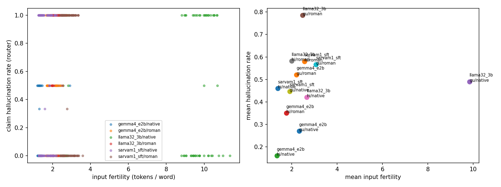

# FactIndic — Experiment 0 (H1 Gate) Report

Pilot: 100 XL-Sum test articles (50 hi + 50 gu), truncated to 350 words, greedy decoding.

## Gate decision

```json
{
  "h1_supported": false,
  "h1_within_model": false,
  "h1_across_model": false,
  "h1_pooled_only": false,
  "sarvam_competitive": false,
  "sarvam_quality_ok": true,
  "mt_engine": {
    "nllb": 2568
  },
  "backbone": "google/gemma-4-E2B-it",
  "rule": "keep Sarvam-1 iff H1 [\u03b2_fertility>0, one-sided p<0.05, in BOTH the within-model (doc+model FE) and across-model (doc\u00d7script FE) specs] AND (Sarvam\u2212Gemma hallucination 95% CI upper bound \u2264 +0.05) AND (Sarvam script adherence \u2265 0.90 AND ROUGE-L \u2265 0.8\u00d7Gemma)"
}
```

## Tokenizer fertility (tokens/word, corpus level, 1,000 sentences per language)

| tokenizer   |   ('gu', 'native') |   ('gu', 'roman') |   ('gu', 'script_mixed') |   ('hi', 'native') |   ('hi', 'roman') |   ('hi', 'script_mixed') |
|:------------|-------------------:|------------------:|-------------------------:|-------------------:|------------------:|-------------------------:|
| gemma4_e2b  |               2.34 |              2.17 |                     2.28 |               1.35 |              1.75 |                     1.34 |
| indicbartss |               1.67 |              2.98 |                     1.66 |               1.37 |              2.47 |                     1.36 |
| llama32_3b  |               9.76 |              2.44 |                     9.33 |               2.65 |              1.98 |                     2.58 |
| sarvam1_sft |               1.9  |              3.03 |                     1.87 |               1.39 |              2.54 |                     1.38 |

## Generators

| model       | hf                               | precision                              |
|:------------|:---------------------------------|:---------------------------------------|
| sarvam1_sft | sarvamai/sarvam-1                | fp32 weights, fp16 autocast            |
| gemma4_e2b  | google/gemma-4-E2B-it            | 4bit-nf4 / fp16 storage / fp32 compute |
| llama32_3b  | meta-llama/Llama-3.2-3B-Instruct | fp16                                   |

## Per model × language × input script

|                                 |   n |   script_adherence |   fertility |   halluc |   halluc_minicheck |   halluc_nli |   anchor_err |   rouge1 |   rouge2 |   rougeL |   words |   tokens |   CR_pct |   latency_s |   peak_vram_gb |
|:--------------------------------|----:|-------------------:|------------:|---------:|-------------------:|-------------:|-------------:|---------:|---------:|---------:|--------:|---------:|---------:|------------:|---------------:|
| ('gemma4_e2b', 'gu', 'native')  |  50 |               1    |       2.321 |    0.27  |              0.27  |        0.14  |        0.024 |   15.641 |    3.279 |   13.737 |   20.18 |    48.44 |    6.351 |      14.65  |          7.035 |
| ('gemma4_e2b', 'gu', 'roman')   |  50 |               0.96 |       2.206 |    0.52  |              0.52  |        0.16  |        0.157 |    8.966 |    0.822 |    7.953 |   19.48 |    44.58 |    6.073 |       9.909 |          7.035 |
| ('gemma4_e2b', 'hi', 'native')  |  50 |               0.98 |       1.341 |    0.162 |              0.162 |        0.134 |        0.056 |   26.743 |    6.845 |   19.639 |   32.74 |    42.44 |   10.984 |      13.188 |          6.998 |
| ('gemma4_e2b', 'hi', 'roman')   |  50 |               1    |       1.758 |    0.35  |              0.35  |        0.12  |        0.038 |   26.351 |    5.049 |   18.396 |   31.52 |    38.98 |   10.589 |       7.733 |          6.998 |
| ('llama32_3b', 'gu', 'native')  |  50 |               1    |       9.847 |    0.49  |              0.49  |        0.286 |        0.033 |   16.363 |    4.633 |   15.195 |   14.24 |   152.08 |    4.472 |      15.267 |         10.956 |
| ('llama32_3b', 'gu', 'roman')   |  50 |               0.98 |       2.473 |    0.77  |              0.77  |        0.32  |        0.264 |   10.052 |    0.71  |    9.276 |   13.5  |   147.3  |    4.311 |       7.05  |         10.956 |
| ('llama32_3b', 'hi', 'native')  |  50 |               1    |       2.662 |    0.42  |              0.42  |        0.11  |        0.085 |   29.539 |    8.704 |   20.958 |   26.58 |    72.34 |    8.945 |       3.713 |          7.007 |
| ('llama32_3b', 'hi', 'roman')   |  50 |               0.98 |       1.992 |    0.57  |              0.57  |        0.33  |        0.066 |   24.52  |    5.08  |   18.108 |   26.46 |    71.96 |    8.824 |       3.432 |          7.007 |
| ('sarvam1_sft', 'gu', 'native') |  50 |               1    |       1.904 |    0.447 |              0.427 |        0.257 |        0.085 |   19.483 |    5.818 |   17.741 |   12.56 |    25.42 |    3.903 |       2.602 |         10.793 |
| ('sarvam1_sft', 'gu', 'roman')  |  50 |               1    |       3.062 |    0.567 |              0.547 |        0.24  |        0.253 |   15.678 |    3.238 |   14.597 |   14.42 |    29.44 |    4.497 |       3.28  |         10.793 |
| ('sarvam1_sft', 'hi', 'native') |  50 |               1    |       1.387 |    0.46  |              0.46  |        0.26  |        0.141 |   30.752 |   10.451 |   24.74  |   19.6  |    25.54 |    6.598 |       2.475 |         10.692 |
| ('sarvam1_sft', 'hi', 'roman')  |  50 |               1    |       2.554 |    0.58  |              0.58  |        0.21  |        0.152 |   28.824 |    9.792 |   23.407 |   20.38 |    26    |    6.783 |       2.781 |         10.692 |

## H1 regressions (cluster-robust SE by article; β on input fertility)

| outcome    | spec         |    beta |     se |   p_two |   p_one |   n |
|:-----------|:-------------|--------:|-------:|--------:|--------:|----:|
| halluc     | pooled_docFE |  0.003  | 0.0108 |  0.7838 |  0.3919 | 594 |
| halluc     | within_model | -0.0219 | 0.0128 |  0.0877 |  0.9561 | 594 |
| halluc     | across_model |  0.0183 | 0.0125 |  0.1442 |  0.0721 | 594 |
| halluc_mc  | pooled_docFE |  0.0038 | 0.0109 |  0.7233 |  0.3617 | 594 |
| halluc_mc  | within_model | -0.0214 | 0.0128 |  0.0951 |  0.9525 | 594 |
| halluc_mc  | across_model |  0.0193 | 0.0126 |  0.1239 |  0.062  | 594 |
| halluc_nli | pooled_docFE |  0.0058 | 0.0086 |  0.5029 |  0.2515 | 594 |
| halluc_nli | within_model | -0.0041 | 0.0098 |  0.6757 |  0.6621 | 594 |
| halluc_nli | across_model |  0.0063 | 0.011  |  0.5658 |  0.2829 | 594 |
| anchor_err | pooled_docFE | -0.0151 | 0.0038 |  0.0001 |  1      | 522 |
| anchor_err | within_model | -0.0195 | 0.0056 |  0.0005 |  0.9998 | 522 |
| anchor_err | across_model | -0.0047 | 0.0036 |  0.185  |  0.9075 | 522 |

Spearman ρ (pooled): {'rho': 0.14635709698743762, 'p': 0.0003451661325991355, 'n': 594}

## Paired native→Romanized shifts

```json
{
  "sarvam1_sft": {
    "n": 100,
    "mean_dF": 1.1620554563194114,
    "mean_dHalluc": 0.12,
    "wilcoxon_p": 0.04553238464562523
  },
  "gemma4_e2b": {
    "n": 97,
    "mean_dF": 0.1511961765032275,
    "mean_dHalluc": 0.20790378006872853,
    "wilcoxon_p": 0.00046545722555074124
  },
  "llama32_3b": {
    "n": 97,
    "mean_dF": -3.989685896841888,
    "mean_dHalluc": 0.23711340206185566,
    "wilcoxon_p": 0.000543804287441944
  }
}
```

## Model contrasts (paired bootstrap, 1,000 resamples)

```json
{
  "sarvam1_sft-gemma4_e2b": {
    "n": 197,
    "mean_diff": 0.18189509306260573,
    "ci95": [
      0.09727157360406093,
      0.26313451776649743
    ]
  },
  "sarvam1_sft-llama32_3b": {
    "n": 197,
    "mean_diff": -0.05752961082910321,
    "ci95": [
      -0.16159052453468697,
      0.03976311336717429
    ]
  },
  "gemma4_e2b-llama32_3b": {
    "n": 194,
    "mean_diff": -0.24828178694158073,
    "ci95": [
      -0.32570876288659795,
      -0.1718213058419244
    ]
  }
}
```


